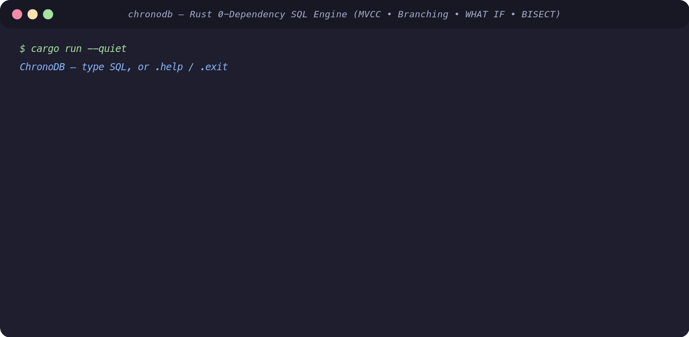

# ChronoDB

**ChronoDB** is a zero-dependency relational database engine built from scratch in Rust with native **MVCC time-travel (`AS OF`)**, **Git-like branching and 3-way DAG merging (`CREATE BRANCH`, `CHECKOUT`, `DIFF`, `MERGE`)**, **logarithmic temporal invariant bisection (`BISECT`)**, and **counterfactual execution (`WHAT IF`)**.



## Key Architecture & Features

| Component | Module | Implementation Highlights |
|---|---|---|
| **SQL Lexer & Recursive-Descent Parser** | `src/parser.rs` | Custom tokenizer & AST parser supporting DDL/DML, computed projections (`AS`), nested boolean/arithmetic expressions, `IN`/`BETWEEN`/`LIKE`/`IS NULL`, transactions, branching, `BISECT`, and `WHAT IF` |
| **Query Planner & Optimizer** | `src/planner.rs` | Logical-to-physical plan lowering with predicate pushdown and automatic B+ tree `IndexScan` / `IndexRangeScan` selection (`EXPLAIN`) |
| **Volcano Execution Engine** | `src/executor.rs` | Pull-based iterator pipeline (`Values`, `Filter`, `Sort`, `Offset`, `Limit`, `Project`) with closure-evaluated projections and typed multi-column sorting |
| **MVCC & Snapshot Isolation** | `src/transaction.rs`, `src/engine.rs` | Per-row immutable version chains (`RowChain`), monotonic commit timestamps, read-your-own-writes isolation, write-write conflict detection, and `VACUUM` garbage collection |
| **Git-Style Branch DAG & 3-Way Merge** | `src/engine.rs` | Copy-on-write branch snapshots, Lowest Common Ancestor (LCA) graph traversal across branch DAGs, and 3-way merge with row- and schema-level conflict detection |
| **Slotted Pages & LRU Buffer Pool** | `src/storage.rs` | 4 KiB fixed-size slotted pages (64-byte header, upward slot directory, bottom-up tuple allocation, defragmentation, FNV-1a checksums) and pin-aware LRU page cache |
| **B+ Tree Storage Index** | `src/btree.rs` | Balanced 64-bit integer B+ tree with node splitting, point lookups, range scans, and checksummed multi-page disk serialization |
| **Temporal Debugging (`BISECT` & `WHAT IF`)** | `src/engine.rs` | `BISECT <table> WHERE <cond>` binary-searches commit history in $O(\log C)$ probes to pinpoint the exact commit that broke an invariant; `WHAT IF (<mutation>) <query>` runs zero-side-effect counterfactual simulations |

## Quick Start

```sh
# Launch interactive REPL
cargo run --

# Execute one-shot SQL command
cargo run -- "CREATE TABLE users (id INTEGER PRIMARY KEY, name STRING, balance INT);"
```

## SQL Tour

```sql
-- 1. Standard relational DDL/DML & computed projections
CREATE TABLE accounts (id INT PRIMARY KEY NOT NULL, owner STRING NOT NULL, balance FLOAT);
INSERT INTO accounts VALUES (1, 'Ada', 1000.0), (2, 'Grace', 2500.0);
SELECT id, owner, balance * 1.05 AS projected FROM accounts WHERE balance >= 1000 ORDER BY balance DESC;

-- 2. Point-in-time Time Travel (AS OF)
UPDATE accounts SET balance = 800.0 WHERE id = 1;
SELECT * FROM accounts AS OF 2;

-- 3. Git-like Branching, Diffing & 3-Way DAG Merge
CREATE BRANCH experiment FROM main;
CHECKOUT experiment;
UPDATE accounts SET balance = 5000.0 WHERE id = 2;
DIFF main experiment;
CHECKOUT main;
MERGE experiment INTO main;

-- 4. Logarithmic Commit Bisection (git bisect for SQL data invariants)
BISECT accounts WHERE balance < 900.0;

-- 5. Ephemeral Counterfactual Simulation (zero side effects on live state)
WHAT IF (UPDATE accounts SET balance = 0.0 WHERE id = 1) SELECT * FROM accounts WHERE balance = 0.0;

-- 6. Audit Trail & Maintenance
SHOW HISTORY accounts;
VACUUM 2;
CHECKPOINT;
```

## Testing

ChronoDB includes 28 unit tests across engine modules and 9 multi-category integration test suites covering lexer/parser edge cases, B+ tree splits, slotted-page buffer pool eviction, MVCC concurrency anomalies (dirty, non-repeatable, and phantom reads), WAL crash recovery, and 3-way branch merges:

```sh
cargo test
```
